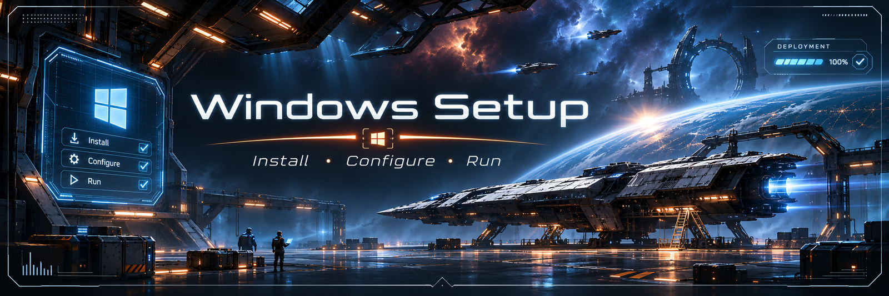
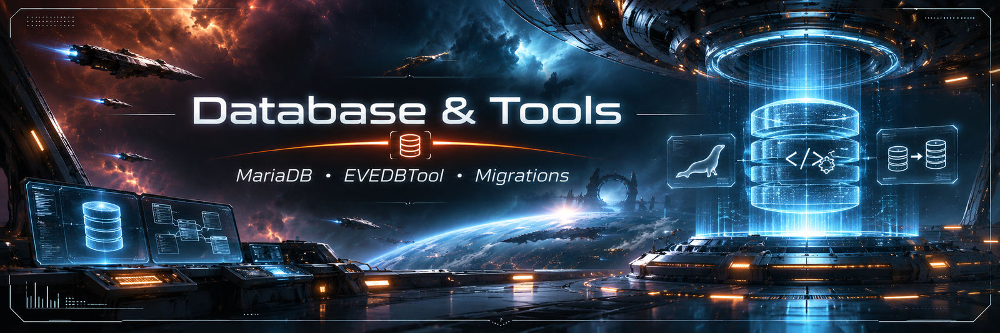

# EVEmu Crucible — maintained Windows, Linux and Docker fork

  

  
  
  
  

[Source](https://github.com/xrizonx/evemu_Crucible) · [CI builds](https://github.com/xrizonx/evemu_Crucible/actions/workflows/build-release.yml) · [Full patch notes](PATCH_NOTES.md) · [Stability worklog](STABILITY_WORKLOG.md) · [Database guide](sql/README.md)

EVEmu is an educational, work-in-progress EVE Online server emulator based on [upstream EVEmu Crucible](https://github.com/EvEmu-Project/evemu_Crucible). It is intended for local development and testing, not public or production hosting.

**Active development and builds: `master`.** The Windows instructions below match this fork's GitHub Actions **Windows x86_64/UCRT64** package. If you already have an EVEmu installation, **back up its database and settings before upgrading**.

## Quick navigation

- [What has changed](#changes-in-this-fork)
- [Download and install on Windows](#windows-11-and-windows-10-x64-setup)
- [MariaDB setup](#3-install-and-configure-mariadb)
- [EVEDBTool and database initialization](#4-configure-evedbtool)
- [Server XML and running EVEmu](#6-configure-the-server)
- [EVEDBTool command reference](#8-evedbtool-commands)
- [Build from master](#9-build-master-locally-on-windows)
- [Upgrade and troubleshoot](#10-upgrading-an-existing-server)
- [Docker/Linux](#docker-and-linux)

## Changes in this fork

For the complete chronological changes, see [PATCH_NOTES.md](PATCH_NOTES.md), [STABILITY_WORKLOG.md](STABILITY_WORKLOG.md), and the [master commit history](https://github.com/xrizonx/evemu_Crucible/commits/master). Major changes through the merged [PR #13](https://github.com/xrizonx/evemu_Crucible/pull/13):

- **Windows and packaging:** modern MSYS2 UCRT64/GCC, CMake/Boost and Windows linker/API compatibility fixes; runtime DLLs bundled **next to `bin\eve-server.exe`**, including `libmariadb.dll`, `libtinyxml-0.dll` and `libz-1.dll`.
- **CI and tests:** Linux GCC, Windows UCRT64, Docker builds, CMake/CTest, weapon-formula tests, ccache, downloadable platform packages and checksums.
- **Database tools:** patched EVEDBTool 0.0.6 compiled for Windows/Linux and included with `base`, `migrations` and `dungeons`; safer market seed handling, dry run, region selection and force-reseeding safeguards.
- **Missions:** Blockade mission and agent acceptance/completion fixes, with ongoing mission-data/UI work. See [mission guide](docs/missions/MIGRATION_GUIDE.md).
- **Drones and targeting:** engage-command decoding, NPC acquisition and control range, aggressive/passive settings, focus fire, orbit/return/combat state transitions, lock callbacks, stale target pruning and entity-lifetime guards.
- **Weapons and fitted modules:** turret optimal/falloff/tracking, missile explosion velocity/radius damage, target validity checks, online/offline state handling, smartbomb AoE, bomb detonation/AoE and defender-missile logic.
- **General stability:** crash-path null checks, module/item safety, expired timer corrections, iterator safety and log cleanup.

**Test limitation:** passing Linux, Windows and Docker CI builds does not prove drone/weapon/mission mechanics are bug-free in a running game. New smartbomb, bomb, defender missile and drone behavior require in-game tests. Report runtime faults with the exact build SHA, logs, reproduction and crash dump.

# Windows 11 and Windows 10 x64 setup

  

You do **not** need Git, Go, a compiler or Docker to run the prebuilt Windows ZIP. You **do** need a Windows MariaDB server and the packaged SQL assets.

## 1. Download the Windows server

1. Open the [master build workflow](https://github.com/xrizonx/evemu_Crucible/actions/workflows/build-release.yml), select a **successful run on master**, and download the `evemu-crucible-windows-x86_64` artifact.
2. GitHub may wrap the package in an outer ZIP. Extract that first, then extract `evemu-crucible-windows-x86_64.zip` to a convenient directory, such as `C:\EVEmu`.
3. Verify `BUILD-INFO.txt` reports the commit and `Windows x86_64 UCRT64`. The Actions artifact retention is 14 days; tagged release packages (when published) are on the [Releases page](https://github.com/xrizonx/evemu_Crucible/releases).

The unpacked layout should include:

~~~text
C:\EVEmu\
  BUILD-INFO.txt
  bin\
    eve-server.exe
    libmariadb.dll
    libtinyxml-0.dll
    libz-1.dll
    ...other runtime DLLs...
  etc\
    devtools.raw
  share\
    evemu\
      sql\
        evedbtool.exe
        evedb.yaml.example
        base\                   (*.sql.gz files)
        migrations\
        dungeons\
      utils\
        config\
          eve-server.xml
          log.ini
          MarketBot.xml
          devtools.raw
      tools\
~~~

**Do not move the DLLs away from `bin\eve-server.exe`.** The compressed SQL data, migration scripts and `evedbtool.exe` must remain together under `share\evemu\sql`.

## 2. Prepare Windows folders and configuration templates

On a **new installation**, open PowerShell:

~~~powershell
Set-Location C:\EVEmu
New-Item -ItemType Directory -Force -Path .\etc, .\logs, .\server_cache, .\image_cache | Out-Null
Copy-Item .\share\evemu\utils\config\eve-server.xml .\etc\eve-server.xml
Copy-Item .\share\evemu\utils\config\log.ini .\etc\log.ini
Copy-Item .\share\evemu\utils\config\MarketBot.xml .\etc\MarketBot.xml
Copy-Item .\share\evemu\utils\config\devtools.raw .\etc\devtools.raw
~~~

These copy commands **replace existing config files**. Do not run them on an upgraded installation without first backing up and comparing your working settings.

The server's default compiled root is `..`, so it expects `..\etc\eve-server.xml` **relative to the working directory**. Run the executable **from `C:\EVEmu\bin`**. Running it from the package root can make its XML and log paths fail.

## 3. Install and configure MariaDB

  

1. Install 64-bit MariaDB Server for Windows from [mariadb.org/download](https://mariadb.org/download/). The Docker image uses MariaDB 11.8; your Windows MariaDB installation is separate.
2. During installation, create a strong **root password**, enable the **MariaDB Windows service**, and use TCP/IP on `3306` (or use your chosen port consistently everywhere).
3. Start/check the service (its name may differ): `Get-Service *maria*` in PowerShell. If MariaDB is not on PATH, open `mariadb.exe` from the installed MariaDB `bin` directory.
4. Open a terminal and connect as MariaDB administrator:

~~~powershell
mariadb -u root -p
~~~

At the `MariaDB>` SQL prompt, create a dedicated local database and account. Replace `REPLACE_WITH_STRONG_PASSWORD` with your **own** secret:

~~~sql
CREATE DATABASE IF NOT EXISTS evemu
  CHARACTER SET utf8mb4 COLLATE utf8mb4_unicode_ci;
CREATE USER IF NOT EXISTS 'evemu'@'localhost'
  IDENTIFIED BY 'REPLACE_WITH_STRONG_PASSWORD';
CREATE USER IF NOT EXISTS 'evemu'@'127.0.0.1'
  IDENTIFIED BY 'REPLACE_WITH_STRONG_PASSWORD';
GRANT ALL PRIVILEGES ON evemu.* TO 'evemu'@'localhost';
GRANT ALL PRIVILEGES ON evemu.* TO 'evemu'@'127.0.0.1';
FLUSH PRIVILEGES;
EXIT;
~~~

Test the dedicated user's TCP connection:

~~~powershell
mariadb --host=127.0.0.1 --port=3306 --user=evemu -p evemu
~~~

Use its new password and type `EXIT;` afterward. Keep the MariaDB port local rather than opening it to the internet. Existing databases should **not** be recreated; use their current database name and credentials.

## 4. Configure EVEDBTool

The **patched Windows** database tool is `C:\EVEmu\share\evemu\sql\evedbtool.exe`. In PowerShell:

~~~powershell
Set-Location C:\EVEmu\share\evemu\sql
Copy-Item .\evedb.yaml.example .\evedb.yaml
notepad .\evedb.yaml
~~~

For the fresh MariaDB setup above, use:

~~~yaml
log-level: Info
db-host: 127.0.0.1
db-port: "3306"
db-user: evemu
db-pass: REPLACE_WITH_STRONG_PASSWORD
db-database: evemu
migrations-dir: migrations
base-dir: base
dungeon-dir: dungeons
seed-regions:
  - Derelik
seed-saturation: 80
~~~

Your `db-pass` must match MariaDB and `eve-server.xml`; your `db-database` must match the database you actually created (the bundled template originally uses `EvE`, so update it to `evemu` for this example). The `base`, `migrations` and `dungeons` paths are **relative to the current `sql` directory**. Always run EVEDBTool from that directory. Keep `evedb.yaml` private and out of Git.

**Source checkout without `evedbtool.exe`?** Install Git and Go **1.23+**, then run `sql\get_evedbtool.bat`. It clones upstream EVEDBTool tag 0.0.6, adds the fork's `tools/evedbtool/command_seed.go` and builds `sql\evedbtool.exe`. The standard Actions ZIP **already includes this patched executable**; no additional download is required.

## 5. Initialize or upgrade the database

**Choose the correct procedure. Never perform the new-install steps on your populated server database.** Stop the server before running schema or seed changes.

### A. Fresh and empty `evemu` database

In `C:\EVEmu\share\evemu\sql`:

~~~powershell
.\evedbtool.exe install
.\evedbtool.exe status
~~~

`install` reads the `base\*.sql.gz` database assets **when there are no tables** and then applies the included migrations. Check its output for errors; `status` lists migration history. You do not need to unpack the `*.sql.gz` files manually.

Optionally import the bundled dungeon JSON files:

~~~powershell
.\evedbtool.exe dungeon apply
.\evedbtool.exe dungeon list
~~~

Optionally seed NPC market **sell and buy** orders in the regions specified by `evedb.yaml`. All newly seeded NPC buy orders offer **100% of published item `invTypes.basePrice`**, with no security modifier. First review the generated SQL:

~~~powershell
.\evedbtool.exe seed -dryrun
.\evedbtool.exe seed
~~~

Normal initial seeding has separate NPC sell and buy entries in `seed_migrations`. On an existing database, run `evedbtool.exe seed -buy-only -dryrun` followed by `evedbtool.exe seed -buy-only` after a backup. Do **not** use `seed -force` for an initial installation or an existing-data buy-only upgrade. See [NPC buy seed verification](docs/NPC_BUY_MARKET_100_PERCENT_2026-11-17.md).

### B. Existing EVEmu database (accounts, characters and inventory retained)

1. Stop `eve-server.exe` and back up the database, `etc` config, and `evedb.yaml`. Example PowerShell backup with MariaDB's `mariadb-dump` utility:

~~~powershell
New-Item -ItemType Directory -Force C:\EVEmu\backups | Out-Null
mariadb-dump --host=127.0.0.1 --port=3306 --user=evemu --password --result-file="C:\EVEmu\backups\evemu-before-update.sql" evemu
~~~

The dump command prompts for a password. Change `evemu` in the final argument if using a different database name. Check that the file is nonempty and that your backup can be restored.

2. Copy your **existing**, private `evedb.yaml` into the new `sql` directory; confirm it points to the same database as the server.
3. Inspect **before** applying migrations:

~~~powershell
Set-Location C:\EVEmu\share\evemu\sql
.\evedbtool.exe status
.\evedbtool.exe up -dryrun
~~~

4. Review the pending migration SQL for schema/data changes. If appropriate and with a verified backup, apply:

~~~powershell
.\evedbtool.exe up
.\evedbtool.exe status
~~~

**Never use `skip` just to bypass migration errors**. If you applied each pending migration manually with a SQL client, follow the [manual migration process](sql/README.md) before recording it as applied with `skip`. `install` is for first-time installation, not the routine way to upgrade an active database.

The separate `sql/mission_data` staging files are **not** automatically installed by this procedure and should only be applied under the [mission migration process](docs/missions/MIGRATION_GUIDE.md).

## 6. Configure the server

Edit `C:\EVEmu\etc\eve-server.xml`. Replace the bundled `database_host` / `database_username` / `database_password` / `database_name` / `database_port` placeholders with the same settings used in MariaDB and `evedb.yaml`:

~~~xml
<database>
    <host>127.0.0.1</host>
    <username>evemu</username>
    <password>REPLACE_WITH_STRONG_PASSWORD</password>
    <db>evemu</db>
    <port>3306</port>
    <ssl>false</ssl>
    <compress>false</compress>
    <useSocket>false</useSocket>
    <autoReconnect>true</autoReconnect>
</database>
~~~

Keep other optional database tags from the actual template. Check the file paths and network configuration:

~~~xml
<files>
    <logDir>../logs/</logDir>
    <logSettings>../etc/log.ini</logSettings>
    <cacheDir>../server_cache/</cacheDir>
    <imageDir>../image_cache/</imageDir>
</files>
<net>
    <port>26000</port>
    <imageServer>127.0.0.1</imageServer>
    <imageServerPort>26001</imageServerPort>
</net>
~~~

- Game login uses TCP port **26000**; the image server uses **26001**.
- `imageServer=127.0.0.1` is only suitable for the EVE client running on the **same PC**. For another computer on the LAN, use an address reachable from that client and allow the two ports through Windows Firewall. Do not open MariaDB port 3306 for game access.
- The client needs to be compatible with the **Crucible-era** protocol; do not expect the current retail client to connect.
- `etc\log.ini` controls logging; `logs`, `server_cache` and `image_cache` should exist and be writable.
- **Complete agent portrait experiment rollback (16 November 2026):** the added NPC-agent portrait helper, importer and fallback JPEG are deleted; the entire HTTP image handler is restored to its **pre-PR #17** version. Player portraits and other image categories follow their historical behavior (including existing external redirects for missing images). The client crash has **not yet been resolved**; see [rollback and crash-triage instructions](docs/AGENT_PORTRAIT_FULL_REMOVAL_2026-11-16.md). Agent missions, market containers and assembled containers remain unchanged.
- **Crucible legacy image compatibility (16 November 2026):** a subsequent focused patch disables the **pre-existing modern HTTPS redirect only for missing `Character` images** (including NPC agent 50px portraits); existing valid local player/agent JPEGs still work. Empty or obviously non-JPEG cached files are rejected, and external redirects for corporation/alliance logos and type icons/renders are preserved. See [current image-response diagnostic](docs/CRUCIBLE_IMAGE_REDIRECT_CRASH_TRIAGE_2026-11-16.md). The station-load crash still needs real client verification.
- **50px station-agent image compatibility trial:** after confirming 404 still coincided with a client crash, the server now serves an exact 50×50, baseline 322-byte neutral JPEG for legacy 3-million-range agent thumbnails, with fully framed HTTP/1.0 200 headers. No original CCP portrait is bundled. Agent journal and cargo container crash/data-loss guards are included. See the [station crash diagnostic runbook](docs/CRUCIBLE_STATION_AGENT_50PX_CLIENT_CRASH_TRIAGE_2026-11-16.md); actual in-client stability is not yet proven.
- `etc\MarketBot.xml` provides market bot settings. The server XML's `<TraderJoe>` option controls that feature. `etc\devtools.raw` is also bundled.
- Edit XML with a plain-text editor; preserve the rest of the template.

## 7. Run and verify EVEmu

Start the MariaDB service, then in **PowerShell**:

~~~powershell
Set-Location C:\EVEmu\bin
.\eve-server.exe
~~~

Watch its startup output for successful configuration parsing, database connection, static data load, and the TCP/image service ports. In a second terminal:

~~~powershell
Test-NetConnection 127.0.0.1 -Port 26000
Test-NetConnection 127.0.0.1 -Port 26001
~~~

A listening port is not an in-game test. Connect with a compatible EVE client; new usernames are normally created automatically on first login. Stop the server cleanly using the console or Ctrl+C before modifying database schema.

If the server cannot open `eve-server.xml`, check your **current working directory**: it must be `C:\EVEmu\bin` with default `EVEMU_ROOT=..`. If it cannot find DLLs, extract the complete build ZIP and keep its bundled DLLs alongside `eve-server.exe`. If database authentication fails, check MariaDB service, permissions and matching XML/YAML credentials.

## 8. EVEDBTool commands

Run all commands from `C:\EVEmu\share\evemu\sql`:

| Command | Meaning |
| --- | --- |
| `.\evedbtool.exe status` | Show migration versions recorded in the database. |
| `.\evedbtool.exe install` | For a **new empty database**: load base tables and migrate. |
| `.\evedbtool.exe up -dryrun` | Print pending migration SQL without changing data. |
| `.\evedbtool.exe up` | Apply pending migrations after review and backup. |
| `.\evedbtool.exe skip` | Record migration versions **without executing SQL**. Use ONLY after the SQL was applied and verified manually. |
| `.\evedbtool.exe seed -dryrun` | Preview market seed SQL. |
| `.\evedbtool.exe seed` | Initial market seed, if not already recorded. |
| `.\evedbtool.exe seed -force -dryrun` | Preview a potentially destructive NPC market rebuild. |
| `.\evedbtool.exe seed -force` | **Destructive market refresh** of qualifying NPC sell orders in selected regions; back up first. Player sell orders are retained. |
| `.\evedbtool.exe dungeon apply` | Import supplied dungeon definitions from `dungeons`. |
| `.\evedbtool.exe dungeon list` | List installed dungeons. |
| `.\evedbtool.exe dungeon list-factions` | Display faction IDs. |
| `.\evedbtool.exe dungeon list-archetypes` | Display archetype IDs. |

`seed-regions` accepts region names or numeric IDs, and `seed-saturation` accepts 1–100. The fork's patched seeder generates 550,000 units for charges/ammunition, 550 of other standard market items, and 10 for qualifying Officer/Deadspace/Faction/Storyline items. `seed -force` **deletes existing NPC corporation sell orders** for configured categories in the selected regions and rebuilds them; do not run without stopping the server, reviewing `-dryrun` and taking a verified backup. Full database-tool documentation: [sql/README.md](sql/README.md).

## 9. Build master locally on Windows

**Recommended:** download the ready-made Windows ZIP from a successful master Actions run. For source builds:

1. Install [Git for Windows](https://git-scm.com/downloads/win) and [MSYS2](https://www.msys2.org/).
2. Open the **MSYS2 UCRT64** terminal; update packages with `pacman -Syu` and reopen the terminal if needed.
3. Install the same dependencies as CI:

~~~bash
pacman -S --needed git \
  mingw-w64-ucrt-x86_64-gcc \
  mingw-w64-ucrt-x86_64-binutils \
  mingw-w64-ucrt-x86_64-cmake \
  mingw-w64-ucrt-x86_64-ninja \
  mingw-w64-ucrt-x86_64-boost \
  mingw-w64-ucrt-x86_64-libmariadbclient \
  mingw-w64-ucrt-x86_64-tinyxml \
  mingw-w64-ucrt-x86_64-utf8cpp \
  mingw-w64-ucrt-x86_64-zlib
~~~

4. Still in UCRT64, clone and compile:

~~~bash
git clone --branch master https://github.com/xrizonx/evemu_Crucible.git
cd evemu_Crucible
cmake -S . -B build -G Ninja -DCMAKE_BUILD_TYPE=Release
cmake --build build --parallel 2
ctest --test-dir build --output-on-failure
cmake --install build --prefix stage
~~~

A **local** `stage/bin/eve-server.exe` installation is **not a standalone portable package**. It still needs matching UCRT64 DLLs (or to be run inside UCRT64), its `etc` files and the SQL assets. CI handles portable DLL collection and file packaging. To build the patched EVEDBTool independently, install Go 1.23+ and run `sql\get_evedbtool.bat` from a source checkout.

Every push to `master` triggers **Linux GCC**, **Windows UCRT64** and **Docker** jobs, including registered CTest tests. Only tag-triggered runs (`v*` or `stable-rizonx`) publish GitHub releases; ordinary branch pushes create temporary artifacts.

## 10. Upgrading an existing server

1. Stop `eve-server.exe`. Back up your MariaDB database, customized `etc` files and private `evedb.yaml`.
2. Extract a **successful master build** into a **new folder** rather than overwriting the working installation.
3. Keep the new `bin` and runtime DLLs together. Copy your current settings, compare new templates with custom values, and retain your saved YAML configuration.
4. Use the new `sql` directory and EVEDBTool to run `status` and `up -dryrun`, then apply only reviewed necessary migrations.
5. Start from the new package's `bin` folder and validate login, missions, drones and modules **before** removing the old installation.

### Troubleshooting

| Symptom | First check |
| --- | --- |
| Config XML missing | Copy `share\evemu\utils\config\eve-server.xml` to `etc` and run from `bin`. |
| Missing `libmariadb.dll` / `libtinyxml-0.dll` / `libz-1.dll` | Extract the **full Windows ZIP**; keep DLLs in `bin` alongside the EXE. |
| Database access denied/refused | MariaDB service, `127.0.0.1:3306`, user grants, XML and YAML password/DB name. |
| Tool cannot read base/migrations | Use `share\evemu\sql` as the working directory; check `evedb.yaml`. |
| Server says database tables are missing | `install` for **empty DB**; `status`/`up -dryrun` for an **existing DB**, after backup. |
| Client connects but image service fails | `imageServer` address, port 26001 and Windows Firewall. |
| Crash or unstable combat | Gather logs, reproduction, `BUILD-INFO.txt` commit and a symbolized crash dump; source CI does not prove runtime safety. |

## Docker and Linux

Docker builds from `master` remain supported for development:

~~~bash
git clone --branch master https://github.com/xrizonx/evemu_Crucible.git
cd evemu_Crucible
docker compose up -d --build
docker compose logs -f server
docker compose stop
~~~

The compose file uses example MariaDB credentials (`evemu/evemu`); change these before shared or public exposure and keep container configuration consistent. Container startup invokes EVEDBTool and is **not** the same as the manual Windows steps above. Linux build artifacts include `sql/evedbtool`, bundled SQL resources and the server installation.

## Further information and legal

[Patch notes](PATCH_NOTES.md) · [Stability/CI](STABILITY_WORKLOG.md) · [Upstream issue triage](ISSUE_TRIAGE.md) · [Database README](sql/README.md) · [Mission guide](docs/missions/MIGRATION_GUIDE.md) · [EVEmu upstream](https://evemu.dev/)

**EVEmu is an educational project.** Its primary purpose is learning and teaching C++, database and network-service development. It is not intended for public servers, is not warranted for production use and does not guarantee bug-free gameplay. Upstream EVEmu copyright and GNU LGPL licensing terms continue to apply.
